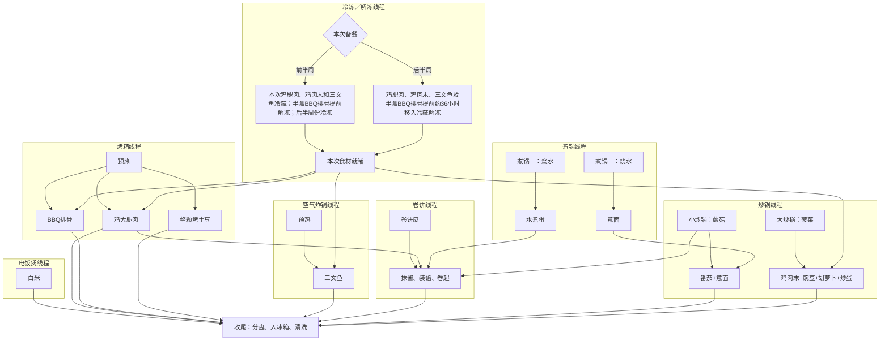

<nav class="page-links" aria-label="做饭页面分区"><a href="#dependencies">任务依赖图</a><a href="#portions">分盘</a><a href="#cold">冷冻／解冻</a><a href="#rice">电饭煲</a><a href="#oven">烤箱</a><a href="#air-fryer">空气炸锅</a><a href="#pots">煮锅</a><a href="#woks">炒锅</a><a href="#wraps">卷饼</a></nav>
## 任务依赖图
{: #dependencies }

## 分盘表
{: #portions }

<table class="plan-table">
<thead>
<tr>
<th>食材</th>
<th>分到第几盘</th>
</tr>
</thead>
<tbody>
<tr>
<td>BBQ排骨</td>
<td>4、7</td>
</tr>
<tr>
<td>水煮蛋</td>
<td>1放2个</td>
</tr>
<tr>
<td>三文鱼</td>
<td>3、4、6、7各1块</td>
</tr>
<tr>
<td>鸡大腿肉</td>
<td>1放2块；3、6各1块</td>
</tr>
<tr>
<td>白米饭</td>
<td>2、5</td>
</tr>
<tr>
<td>鸡肉末+豌豆+胡萝卜+炒蛋</td>
<td>2、5</td>
</tr>
<tr>
<td>番茄+意面</td>
<td>3、6</td>
</tr>
<tr>
<td>烤土豆</td>
<td>4、7</td>
</tr>
<tr>
<td>全麦卷饼皮</td>
<td>1</td>
</tr>
<tr>
<td>Chipotle蛋黄酱</td>
<td>1</td>
</tr>
<tr>
<td>蘑菇</td>
<td>1、4、7各1/3</td>
</tr>
<tr>
<td>菠菜</td>
<td>4、7</td>
</tr>
</tbody>
</table>

## 冷冻／解冻线程
{: #cold }

1. 前半周：冷冻后半周的鸡腿肉、鸡肉末、三文鱼和半盒排骨。
2. 后半周：提前约36小时将冷冻的鸡腿肉、鸡肉末、三文鱼和半盒排骨移入冷藏解冻。

## 电饭煲线程
{: #rice }

1. 白米：量取干米120 mL（约96 g）淘洗沥干，加水约120 mL，用 White Rice（白米）模式煮，约50分钟。

## 烤箱线程
{: #oven }

调味表：橄榄油短喷约30喷＝1茶匙；粉状调味料约30下＝1茶匙

<table class="plan-table">
<thead>
<tr>
<th>食材</th>
<th>橄榄油</th>
<th>盐</th>
<th>黑胡椒</th>
<th>蒜粉</th>
<th>洋葱粉</th>
<th>红椒粉</th>
<th>干牛至叶</th>
</tr>
</thead>
<tbody>
<tr>
<td>鸡大腿肉</td>
<td>1/2 茶匙</td>
<td>1/8 茶匙</td>
<td>—</td>
<td>1/2 茶匙</td>
<td>1/2 茶匙</td>
<td>1 茶匙</td>
<td>1/2 茶匙</td>
</tr>
<tr>
<td>烤土豆</td>
<td>1/2 茶匙</td>
<td>1/8 茶匙</td>
<td>1/8 茶匙</td>
<td>1/4 茶匙</td>
<td>1/4 茶匙</td>
<td>—</td>
<td>—</td>
</tr>
</tbody>
</table>

1. 烤箱400°F预热，需15分钟。
2. 鸡大腿肉：取4块擦干、调味，400°F烤27分钟；第1盘的2块掰碎，第3、6盘各放1块。
3. 烤土豆：取半袋340 g，整颗拌调味，铺在烤盘上，400°F烤约30分钟至叉子能轻松刺入；均分到第4、7盘。
4. BBQ排骨：取已解冻的半盒，淋上包装内酱汁、用锡纸包好，400°F烤15–20分钟，确认中心达74°C；第4、7盘各放1/4盒。

## 空气炸锅线程
{: #air-fryer }

调味表：橄榄油短喷约30喷＝1茶匙；粉状调味料约30下＝1茶匙

<table class="plan-table">
<thead>
<tr>
<th>食材</th>
<th>橄榄油</th>
<th>盐</th>
<th>黑胡椒</th>
<th>蒜粉</th>
<th>洋葱粉</th>
<th>红椒粉</th>
<th>干牛至叶</th>
</tr>
</thead>
<tbody>
<tr>
<td>三文鱼</td>
<td>1/2 茶匙</td>
<td>1/8 茶匙</td>
<td>1/2 茶匙</td>
<td>—</td>
<td>—</td>
<td>1 茶匙</td>
<td>—</td>
</tr>
</tbody>
</table>

1. 空气炸锅400°F预热，需4分钟。
2. 三文鱼：取2盒共4块，擦干、调味，400°F烤8分钟至熟透；第3、4、6、7盘各放1块。

## 煮锅线程
{: #pots }

### 煮锅一

1. 水煮蛋：烧水煮鸡蛋2个，水开后煮约8分钟；掰碎后放第1盘。

### 煮锅二

1. 意面：烧水煮干面90 g，煮约8分钟。

## 炒锅线程
{: #woks }

调味表：橄榄油短喷约30喷＝1茶匙；粉状调味料约30下＝1茶匙

<table class="plan-table">
<thead>
<tr>
<th>食材</th>
<th>橄榄油</th>
<th>黑胡椒</th>
<th>蒜粉</th>
<th>洋葱粉</th>
<th>意式混合香草</th>
<th>酱油</th>
<th>鸡粉</th>
</tr>
</thead>
<tbody>
<tr>
<td>鸡肉末+豌豆+胡萝卜+炒蛋</td>
<td>1 茶匙</td>
<td>—</td>
<td>1/4 茶匙</td>
<td>1/4 茶匙</td>
<td>—</td>
<td>3 茶匙</td>
<td>1/8 茶匙</td>
</tr>
<tr>
<td>菠菜</td>
<td>1 茶匙</td>
<td>—</td>
<td>1/4 茶匙</td>
<td>1/4 茶匙</td>
<td>—</td>
<td>—</td>
<td>—</td>
</tr>
<tr>
<td>番茄+意面</td>
<td>1/2 茶匙</td>
<td>1/4 茶匙</td>
<td>1/2 茶匙</td>
<td>—</td>
<td>1/2 茶匙</td>
<td>—</td>
<td>—</td>
</tr>
<tr>
<td>蘑菇</td>
<td>1/4 茶匙</td>
<td>1/4 茶匙</td>
<td>1/2 茶匙</td>
<td>1/2 茶匙</td>
<td>—</td>
<td>—</td>
<td>—</td>
</tr>
</tbody>
</table>

### 小炒锅

1. 蘑菇：取1盒227 g，大火加油、调味，炒约7分钟至熟；均分到第1、4、7盘。
2. 番茄+意面：用番茄意面酱半瓶，小火加油、调味，煮2–3分钟；拌入意面煮约3分钟至热透；均分到第3、6盘。

### 大炒锅

1. 菠菜：取2盒共284 g，大火加油、调味，炒约7分钟至熟；均分到第4、7盘。
2. 鸡肉末+豌豆+胡萝卜+炒蛋：炒完菠菜后擦干锅；中火加1/2茶匙油，放入鸡肉末1盒，铺开稍定型后炒散至中心74°C；加入沥干的豌豆+胡萝卜1罐炒热；将肉菜拨到锅边，转中小火在空处再加1/2茶匙油，倒入4个打散的鸡蛋和调味，炒至凝固后拌匀；均分到第2、5盘。

## 卷饼线程
{: #wraps }

1. 全麦卷饼皮抹 Hellmann’s Mild Chipotle 蛋黄酱1茶匙（约5 mL）。
2. 将掰碎的鸡大腿肉、水煮蛋和蘑菇放入大号卷饼皮，卷好放第1盘。
