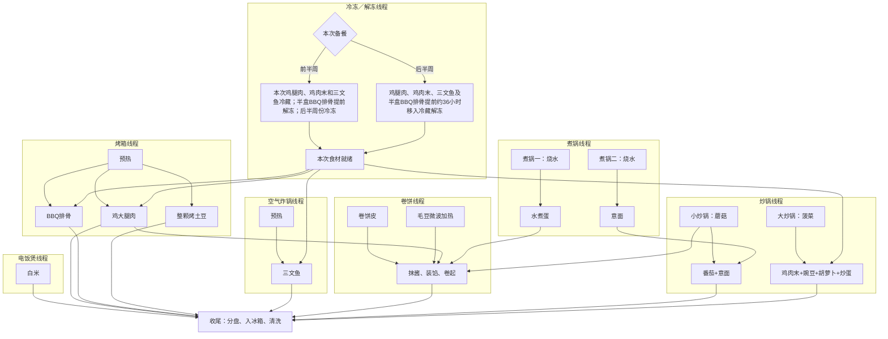

## 计划表

早餐：高纤维谷物早餐40 g + 无糖豆奶约270 g + 一水肌酸 5g + 水果（周日到周二混合水果拼盘，周三到周六每天3个奇异果）

| 编号 | 星期 | 餐次 | 碳水 | 蛋白质 | 蔬菜 | 热量（kcal） |
|---|---|---|---|---|---|---:|
| 上1 | 周日 | 晚餐 | 卷饼皮 | 鸡大腿肉2块＋水煮蛋2个 | 蘑菇+毛豆 | 685 |
| 上2 | 周一 | 午餐 | 白米饭 | 鸡肉末炒蛋2个 | 豌豆+胡萝卜 | 669 |
| 上3 | 周一 | 晚餐 | 意面 | 鸡大腿肉1块＋三文鱼1块 | 番茄 | 667 |
| 上4 | 周二 | 午餐 | 烤土豆 | BBQ排骨1/4盒＋三文鱼1块 | 菠菜+蘑菇 | 666 |
| 上5 | 周二 | 晚餐 | 白米饭 | 鸡肉末炒蛋2个 | 豌豆+胡萝卜 | 669 |
| 上6 | 周三 | 午餐 | 意面 | 鸡大腿肉1块＋三文鱼1块 | 番茄 | 667 |
| 上7 | 周三 | 晚餐 | 烤土豆 | BBQ排骨1/4盒＋三文鱼1块 | 菠菜+蘑菇 | 666 |
| 下1 | 周四 | 午餐 | 卷饼皮 | 鸡大腿肉2块＋水煮蛋2个 | 蘑菇+毛豆 | 685 |
| 下2 | 周四 | 晚餐 | 白米饭 | 鸡肉末炒蛋2个 | 豌豆+胡萝卜 | 669 |
| 下3 | 周五 | 午餐 | 意面 | 鸡大腿肉1块＋三文鱼1块 | 番茄 | 667 |
| 下4 | 周五 | 晚餐 | 烤土豆 | BBQ排骨1/4盒＋三文鱼1块 | 菠菜+蘑菇 | 666 |
| 下5 | 周六 | 午餐 | 白米饭 | 鸡肉末炒蛋2个 | 豌豆+胡萝卜 | 669 |
| 下6 | 周六 | 晚餐 | 意面 | 鸡大腿肉1块＋三文鱼1块 | 番茄 | 667 |
| 下7 | 周日 | 午餐 | 烤土豆 | BBQ排骨1/4盒＋三文鱼1块 | 菠菜+蘑菇 | 666 |
{: .table-centered}

滚动备餐：周日午餐饭后做上1–上7；周三晚餐饭后做下1–下7。周二中午记得拿出冻肉到冷藏解冻。

## 购物表

| 食材 | 商品 | 购买频率 | 每周价格（CAD） |
| --- | --- | ---: | ---: |
| 去骨去皮鸡大腿肉 | [Maple Leaf Boneless Skinless Chicken Thighs Value Pack](https://www.walmart.ca/en/ip/maple-leaf-boneless-skinless-chicken-thighs-value-pack/6000197999724) 8块装；按830 g / 盒估算 | 1盒 / 周 | 约$14.88 |
| BBQ熟猪背排骨 | [Swiss Chalet Smoky BBQ Pork Back Ribs](https://www.walmart.ca/en/ip/swiss-chalet-smoky-bbq-pork-back-ribs-600g/6000197977827) 600 g / 盒，含骨及酱汁；营养暂估397 g可食部分 / 盒 | 1盒 / 周 | 约$12.97 |
| 三文鱼 | [Your Fresh Market Coho Salmon Portions](https://www.walmart.ca/en/ip/Your-Fresh-Market-Coho-Salmon-Portions/6000208252814) 每盒2块，按320 g / 盒计算 | 4盒（8块）/ 周 | 约$41.88 |
| 特瘦鸡肉末 | [Prime Extra Lean Ground Chicken](https://www.walmart.ca/en/ip/Prime-Extra-Lean-Ground-Chicken-Raised-Without-Antibiotics-454-g/10243782) 454 g / 盒 | 2盒 / 周 | $15.96 |
| 鸡蛋 | [Great Value Large Eggs](https://www.walmart.ca/en/ip/Great-Value-Large-Eggs/10052944) 12个 / 盒 | 1盒 / 周 | $3.93 |
| 无糖豆奶 | [Silk Soy Milk Alternative Unsweetened](https://www.walmart.ca/en/ip/Silk-Soy-Milk-Alternative-Unsweetened-Dairy-Free-of-protein/6000190182706) 1.89 L / 桶 | 2桶 / 周 | $9.96 |
| Fresca无糖汽水 | [Fresca Citrus Soda](https://www.walmart.ca/en/ip/Fresca-Citrus-Soda-Pop-Fridge-Pack-Cans-355-mL-12-pack/10277189) 12罐×355 mL / 箱 | 1箱 / 周 | $8.28 |
| 土豆 | [The Little Potato Company Little Yellows（Boomer Gold）](https://www.walmart.ca/en/ip/the-little-potato-company-fresh-little-potatoes-15lb-little-yellows/6000201597418) 680 g / 袋 | 1袋 / 周 | 约$2.74 |
| 豌豆+胡萝卜 | [Great Value Peas and Carrots](https://www.walmart.ca/en/ip/Great-Value-Peas-and-Carrots-398-mL/5YDQIJZT1APQ) 398 mL / 罐 | 2罐 / 周 | 约$2.74 |
| 冷冻去壳毛豆 | [Nature’s Classic Young Edamame Shelled Soybean](https://www.walmart.ca/en/ip/Natures-Classic-Young-Edamame-Shelled-Soybean/6000197072340) 454 g / 盒（2袋×227 g） | 按需补 | 约$0.19 |
| 蘑菇 | [Your Fresh Market Sliced Cremini Mushrooms](https://www.walmart.ca/en/ip/mushrooms-sliced-cremini-your-fresh-market/6000196148725) 227 g / 盒 | 2盒 / 周 | $4.88 |
| 嫩菠菜 | [Your Fresh Market Baby Spinach](https://www.walmart.ca/en/ip/baby-spinach-142g/1Z471AOSG7GL) 142 g / 盒 | 4盒 / 周 | $13.76 |
| 番茄意面酱 | [Catelli Garden Select Tomato & Basil Pasta Sauce](https://www.walmart.ca/en/ip/Catelli-Garden-Select-Tomato-Basil-Pasta-Sauce-600-mL-Jar/3B5Q7OZH5XF7) 600 mL / 瓶 | 1瓶 / 周 | $2.67 |
| 新鲜混合水果盘 | [Your Fresh Market Extra Large Party Fruit Tray](https://www.walmart.ca/en/ip/extra-large-party-fruit-tray-your-fresh-market/6000205351497) 1.3 kg / 盘 | 1盘 / 周 | 约$15.97 |
| 完整奇异果 | [Zespri Kiwi](https://www.walmart.ca/en/ip/kiwi/6000196794990) 单颗售卖 | 12个 / 周 | 约$11.64 |
| 意面 | [Primo Spaghetti](https://www.walmart.ca/en/ip/PRIMO-SPAGHETTI/1YCQ0A4KHLLW) 454 g / 包 | 按需补 | 约$0.50 |
| 全麦卷饼皮 | [Dempster’s 100% Whole Wheat Large Tortillas](https://www.walmart.ca/en/ip/Dempster-s-100-Whole-Wheat-Large-Tortillas/6000191270091) 610 g / 袋，10片（61 g / 片） | 按需补 | 约$0.86 |
| Chipotle蛋黄酱 | [Hellmann’s Mild Chipotle Mayonnaise](https://www.walmart.ca/en/ip/Hellmann-s-Chipotle-Mayonnaise-Mild-Dressing-340ml/5NDTYWNJRQ1Y) 340 mL / 瓶 | 按需补 | 约$0.06 |
| 白米 | [Great Value Long Grain White Rice](https://www.walmart.ca/en/ip/Great-Value-Long-Grain-White-Rice/4UD9P76BEQB4) 900 g / 袋 | 按需补 | 约$0.74 |
| 高纤维谷物早餐 | [Fibre One Crunchy Original](https://www.walmart.ca/en/ip/Fibre-One-Breakfast-Cereal-Crunchy-Original-High-Fibre-and-Whole-Grains-587-g/1OUNWA7P5WCS) 587 g / 盒 | 按需补 | 约$2.61 |
| 黑胡椒 | [Great Value Ground Black Pepper](https://www.walmart.ca/en/ip/Great-Value-Ground-Black-Pepper/10302291) 85 g / 瓶 | 按需补 | 约$0.19 |
| 蒜粉 | [Great Value Garlic Powder](https://www.walmart.ca/en/ip/Great-Value-Garlic-Powder/10303864) 320 g / 瓶 | 按需补 | 约$0.45 |
| 洋葱粉 | [Great Value Onion Powder](https://www.walmart.ca/en/ip/Great-Value-Onion-Powder/10303684) 150 g / 瓶 | 按需补 | 约$0.25 |
| 红椒粉 | [Great Value Paprika](https://www.walmart.ca/en/ip/Great-Value-Paprika/10303778) 130 g / 瓶 | 按需补 | 约$0.36 |
| 干牛至叶 | [Great Value Oregano Leaves](https://www.walmart.ca/en/ip/Great-Value-Oregano-Leaves/6000202666145) 32 g / 瓶 | 按需补 | 约$0.10 |
| 意式混合香草 | [Great Value Italian Seasoning](https://www.walmart.ca/en/ip/Great-Value-Italian-Seasoning/10302881) 50 g / 瓶 | 按需补 | 约$0.09 |
| 盐 | [Windsor Iodized Table Salt](https://www.walmart.ca/en/ip/windsor-table-salt/10210128) 1 kg / 盒 | 按需补 | 约$0.01 |
| 橄榄油 | [Great Value Extra Virgin Olive Oil](https://www.walmart.ca/en/ip/seort/6000203408497) 1 L / 瓶 | 按需补 | 约$0.46 |
| 减盐酱油 | [Great Value Reduced Sodium Soya Sauce](https://www.walmart.ca/en/ip/Great-Value-Reduced-Sodium-Soya-Sauce/6000187053934) 450 mL / 瓶 | 按需补 | 约$0.15 |
| 鸡粉 | [Knorr Chicken Instant Stock Mix](https://www.walmart.ca/en/ip/Knorr-Chicken-Instant-Stock-Mix/10303650) 150 g / 罐 | 按需补 | 约$0.03 |
| 一水肌酸 | [LEANFIT SPORT Creatine Monohydrate — Unflavoured（Walmart）](https://www.walmart.ca/fr/ip/leanfit-sport-creatine-monohydrate-en-poudre-non-aromatis-300-g-5-g-de-cratine-par-portion-certification-informed-choice-cratine-micronise-et-de-quali/6000208594600) 无味，300 g / 罐，参考$27.98 | 按需补 | 约$3.26 |
| 每周合计 | — | — | 约$173 |
{: .table-centered}

## 并行做菜流程

### 任务依赖图

### 分盘表

| 食材 | 分到第几盘 |
|---|---|
| BBQ排骨 | 4、7 |
| 水煮蛋 | 1放2个 |
| 三文鱼 | 3、4、6、7各1块 |
| 鸡大腿肉 | 1放2块；3、6各1块 |
| 白米饭 | 2、5 |
| 鸡肉末+豌豆+胡萝卜+炒蛋 | 2、5 |
| 番茄+意面 | 3、6 |
| 烤土豆 | 4、7 |
| 全麦卷饼皮 | 1 |
| Chipotle蛋黄酱 | 1 |
| 毛豆（卷饼馅） | 1 |
| 蘑菇 | 1、4、7 （1/5+2/5+2/5） |
| 菠菜 | 4、7 |
{: .table-centered}

### 冷冻／解冻线程

1. 前半周：冷冻后半周的鸡腿肉、鸡肉末、三文鱼和半盒排骨。
2. 后半周：提前约36小时将冷冻的鸡腿肉、鸡肉末、三文鱼和半盒排骨移入冷藏解冻。

### 电饭煲线程

1. 白米：量取干米120 mL（约96 g）淘洗沥干，加水约120 mL，用 White Rice（白米）模式煮，约50分钟。

### 烤箱线程

调味表：橄榄油短喷约30喷＝1茶匙；粉状调味料约30下＝1茶匙

| 食材 | 橄榄油 | 盐 | 黑胡椒 | 蒜粉 | 洋葱粉 | 红椒粉 | 干牛至叶 |
|---|---|---|---|---|---|---|---|
| 鸡大腿肉 | 1/2 茶匙 | 1/8 茶匙 | — | 1/2 茶匙 | 1/2 茶匙 | 1 茶匙 | 1/2 茶匙 |
| 烤土豆 | 1/2 茶匙 | 1/8 茶匙 | 1/8 茶匙 | 1/4 茶匙 | 1/4 茶匙 | — | — |
{: .table-centered}

1. 烤箱400°F预热，需15分钟。
2. 鸡大腿肉：取4块擦干、调味，400°F烤27分钟；第1盘的2块掰碎，第3、6盘各放1块。
3. 烤土豆：取半袋340 g，整颗拌调味，铺在烤盘上，400°F烤约30分钟至叉子能轻松刺入；均分到第4、7盘。
4. BBQ排骨：取已解冻的半盒，淋上包装内酱汁、用锡纸包好，400°F烤15–20分钟，确认中心达74°C；第4、7盘各放1/4盒。

### 空气炸锅线程

调味表：橄榄油短喷约30喷＝1茶匙；粉状调味料约30下＝1茶匙

| 食材 | 橄榄油 | 盐 | 黑胡椒 | 蒜粉 | 洋葱粉 | 红椒粉 | 干牛至叶 |
|---|---|---|---|---|---|---|---|
| 三文鱼 | 1/2 茶匙 | 1/8 茶匙 | 1/2 茶匙 | — | — | 1 茶匙 | — |
{: .table-centered}

1. 空气炸锅400°F预热，需4分钟。
2. 三文鱼：取2盒共4块，擦干、调味，400°F烤8分钟至熟透；第3、4、6、7盘各放1块。

### 煮锅线程

#### 煮锅一

1. 水煮蛋：烧水煮鸡蛋2个，水开后煮约8分钟；掰碎后放第1盘。

#### 煮锅二

1. 意面：烧水煮干面90 g，煮约8分钟。

### 炒锅线程

调味表：橄榄油短喷约30喷＝1茶匙；粉状调味料约30下＝1茶匙

| 食材 | 橄榄油 | 黑胡椒 | 蒜粉 | 洋葱粉 | 意式混合香草 | 酱油 | 鸡粉 |
|---|---|---|---|---|---|---|---|
| 鸡肉末+豌豆+胡萝卜+炒蛋 | 1 茶匙 | — | 1/4 茶匙 | 1/4 茶匙 | — | 3 茶匙 | 1/8 茶匙 |
| 菠菜 | 1 茶匙 | — | 1/4 茶匙 | 1/4 茶匙 | — | — | — |
| 番茄+意面 | 1/2 茶匙 | 1/4 茶匙 | 1/2 茶匙 | — | 1/2 茶匙 | — | — |
| 蘑菇 | 1/4 茶匙 | 1/4 茶匙 | 1/2 茶匙 | 1/2 茶匙 | — | — | — |
{: .table-centered}

#### 小炒锅

1. 蘑菇：取1盒227 g，大火加油、调味，炒约7分钟至熟；1/5放第1盘，其余4/5均分到第4、7盘。
2. 番茄+意面：用番茄意面酱半瓶，小火加油、调味，煮2–3分钟；拌入意面煮约3分钟至热透；均分到第3、6盘。

#### 大炒锅

1. 菠菜：取2盒共284 g，大火加油、调味，炒约7分钟至熟；均分到第4、7盘。
2. 鸡肉末+豌豆+胡萝卜+炒蛋：炒完菠菜后擦干锅；中火加1/2茶匙油，放入鸡肉末1盒，铺开稍定型后炒散至中心74°C；加入沥干的豌豆+胡萝卜1罐炒热；将肉菜拨到锅边，转中小火在空处再加1/2茶匙油，倒入4个打散的鸡蛋和调味，炒至凝固后拌匀；均分到第2、5盘。

### 卷饼线程

1. 全麦卷饼皮抹 Hellmann’s Mild Chipotle 蛋黄酱1/2茶匙（约2.5 mL）。
2. 冷冻去壳毛豆10 g微波加热至热透，稍放凉。
3. 将毛豆、掰碎的鸡大腿肉、水煮蛋和蘑菇放入大号卷饼皮，卷好放第1盘。

## 放纵餐

### 常见放纵餐

| 食物 | 份量 | 热量（kcal） | 占参考赤字3,739 kcal（额外加吃） | 剩余每周赤字（kcal，额外加吃） | 剩余日均赤字（kcal） |
|---|---|---:|---:|---:|---:|
| [酱蒜无骨炸鸡（bb.q Chicken Soy Garlic Chicken）](https://www.bbqchickenca.com/) | 1整份，1.2 lb | 1,156，菜单标注 | 约31% | 2,583.12 | 369.02 |
| [凯撒鸡肉卷（6IXTY WINGS Chicken Caesar Wrap）](https://6ixtywings.com/menu_items/chicken-caesar-wrap/) | 1个＋默认普通薯条 | 估1,100–1,500 | 约29–40% | 2,239.12–2,639.12 | 319.87–377.02 |
| [炸鸡汉堡（Burger Burger Johnny Cash Chicken）](https://order.online/store/burger-burger-25113744) | 1个 | 估750–1,050 | 约20–28% | 2,689.12–2,989.12 | 384.16–427.02 |
| [炸鸡排套餐（Ozen Sushi Chicken Katsu Combo）](https://www.ubereats.com/ca/store/ozen-sushi/yCgRS0Q7S_Wlx8Flww4rWQ) | 1整套，含米饭、饺子、yam配菜、汤及沙拉 | 估1,100–1,600 | 约29–43% | 2,139.12–2,639.12 | 305.59–377.02 |
| [脆鸡沙威玛卷（Osmow’s Crispy Chicken Shawarma Wrap）](https://osmows.com/nutrition-calculator) | 1个Regular，含蒜酱及OzPotle酱 | 估750–1,050 | 约20–28% | 2,689.12–2,989.12 | 384.16–427.02 |
| 新奥尔良烤翅（Mr. Panda BBQ Sweet Roasted Chicken Wings） | 1整份，1 lb带骨 | 估650–950 | 约17–25% | 2,789.12–3,089.12 | 398.45–441.30 |
| [Pepperoni 披萨（Pizza Pizza，大号）](https://www.pizzapizza.ca/about-us/nutrition/large-pizza/) | 3片 | 约750 | 约20% | 2,989.12 | 427.02 |
| [奥利奥暴风雪冰淇淋（DQ OREO Cookie Blizzard）](https://www.dairyqueen.com/en-ca/nutrition/food-treats/) | 1杯Small | 约670 | 约18% | 3,069.12 | 438.45 |
| [炒饭（Panda Express Fried Rice，美版参考）](https://www.pandaexpress.com/nutritioninformation) | 1份约312 g | 约620 | 约17% | 3,119.12 | 445.59 |
| [肉汁奶酪薯条（Pizza Pizza Classic Poutine）](https://www.pizzapizza.ca/about-us/nutrition/poutine/) | 1份 | 约600 | 约16% | 3,139.12 | 448.45 |
| [巨无霸汉堡（加拿大 McDonald’s）](https://rippedrestaurants.com/ca/chains/mcdonalds/big-mac) | 1个，不含薯条和饮料 | 约570 | 约15% | 3,169.12 | 452.73 |
| [炸鸡汉堡（KFC Famous Chicken Sandwich）](https://assets.ctfassets.net/a2mgcrjjefyo/3AUi2N7aacNo4rjQ1jE3di/4de20ade3ee68d86901ad9d97230accf/KFC_Website_Nutritional_Information__W4_2024_.pdf) | 1个，不含薯条和饮料 | 约540 | 约14% | 3,199.12 | 457.02 |
| [巧克力奶昔（DQ Chocolate Shake）](https://www.dairyqueen.com/en-ca/nutrition/food-treats/) | 1杯Small | 约530 | 约14% | 3,209.12 | 458.45 |
| [陈皮鸡（Panda Express Orange Chicken，美版参考）](https://www.pandaexpress.com/nutritioninformation) | 1份约168 g，不含米饭 | 约510 | 约14% | 3,229.12 | 461.30 |
| [迷你布朗尼（Pizza Pizza Two-Bite Brownies）](https://www.pizzapizza.ca/about-us/nutrition/desserts/) | 6个 | 约480 | 约13% | 3,259.12 | 465.59 |
| [炸鸡（KFC Original Recipe）](https://assets.ctfassets.net/a2mgcrjjefyo/3AUi2N7aacNo4rjQ1jE3di/4de20ade3ee68d86901ad9d97230accf/KFC_Website_Nutritional_Information__W4_2024_.pdf) | 2块鸡大腿，不含配餐和蘸酱 | 约440 | 约12% | 3,299.12 | 471.30 |
| [原味波浪薯片（Wavy Lay’s）](https://www.tastyrewards.com/en-ca/brands/lays/products/wavy-laysr-original-potato-chips) | 75 g | 约420 | 约11% | 3,319.12 | 474.16 |
| [焦糖星冰乐（Starbucks Caramel Frappuccino）](https://fr.starbucks.ca/menu/product/424/iced) | 1杯Grande，473 mL，标准配方 | 约380 | 约10% | 3,359.12 | 479.87 |
| [牧场酱脆鸡卷（DQ Ranch Crispy Chicken Wrap）](https://www.dairyqueen.com/en-ca/nutrition/food-treats/) | 1个 | 约340 | 约9% | 3,399.12 | 485.59 |
| [炸鸡柳（DQ Chicken Strips）](https://www.dairyqueen.com/en-ca/nutrition/food-treats/) | 3条，不含蘸酱 | 约320 | 约9% | 3,419.12 | 488.45 |
| [薯条（DQ Fries）](https://www.dairyqueen.com/en-ca/nutrition/food-treats/) | 1份Regular，不含蘸酱 | 约280 | 约7% | 3,459.12 | 494.16 |
| [炸洋葱圈（DQ Onion Rings）](https://www.dairyqueen.com/en-ca/nutrition/food-treats/) | 1份Regular，不含蘸酱 | 约260 | 约7% | 3,479.12 | 497.02 |
| [香草冰淇淋（DQ Vanilla Cone）](https://www.dairyqueen.com/en-ca/nutrition/food-treats/) | 1个Small甜筒，不加脆皮和配料 | 约230 | 约6% | 3,509.12 | 501.30 |
| [普通雪碧](https://www.coca-cola.com/ca/en/brands/sprite/products) | 1瓶500 mL | 约200 | 约5% | 3,539.12 | 505.59 |
| [普通可口可乐](https://www.repertoirealimentsquebecois.gouv.qc.ca/Produit/Index/8203394) | 1罐355 mL | 约140 | 约4% | 3,599.12 | 514.16 |
{: .table-centered}

### 零卡或低卡放纵餐替代品

以下为可选替代，不计入固定饮食；若额外加吃，仍扣减相应热量赤字。

| 想吃／喝 | 替代品 | 份量 | 热量（kcal） | 占参考赤字3,739 kcal（额外加吃） |
|---|---|---|---:|---:|
| 含糖可乐 | [Coca-Cola Zero Sugar Zero Caffeine](https://www.walmart.ca/en/ip/Coca-Cola-Zero-Sugar-Zero-Caffeine-355mL-Can-12-Pack/6000202941547) | 1罐355 mL | 0 | 0% |
| 汽水，不想要甜味 | [bubly Lime Sparkling Water](https://www.walmart.ca/en/ip/Bubly-Lime-Sparkling-Water-355ml-cans-pack-of-12/6000197924484) | 1罐355 mL | 0 | 0% |
| 含糖冰茶 | [Nestea Zero Sugar Iced Tea](https://www.walmart.ca/en/ip/Nestea-Zero-Sugar-Iced-Tea-473mL/2QW2HXHP2Z41) | 1瓶473 mL | 约10 | 约0.3% |
| 果冻、甜点 | [Jell-O Zero Sugar Strawberry Jelly Powder Mix](https://www.walmart.ca/en/ip/Jell-O-Strawberry-Jelly-Powder-Light-Gelatin-Mix/6000188760145) | 加水制成125 mL | 约10 | 约0.3% |
| 巧克力甜点 | [Snack Pack No Sugar Added Chocolate Pudding Cups](https://www.walmart.ca/en/ip/seort/10287782) | 1杯99 g | 约60 | 约1.6% |
| 香草奶味甜点 | [Snack Pack No Sugar Added Vanilla Pudding Cups](https://www.walmart.ca/en/ip/snack-pack-no-sugar-added-vanilla-pudding-cups/10287875) | 1杯99 g | 约60 | 约1.6% |
| 冰淇淋、雪糕 | [DEL MONTE Strawberry Frozen Fruit Bars](https://www.walmart.ca/en/ip/DEL-MONTE-Strawberry-Frozen-Fruit-Bars-10-x-50-ml/6000202764024) | 1支50 mL | 约50 | 约1.3% |
| 巧克力雪糕 | [Popsicle Fudgsicle Frozen Dairy Dessert Bars](https://www.walmart.ca/en/ip/Popsicle-Fudgsicle-Frozen-Dairy-Dessert-Bars-12-x-60-ml/6000195509106) | 1支60 mL | 约80 | 约2.1% |
| 奶味冰淇淋 | [Halo Top Vanilla Bean Frozen Dessert](https://www.walmart.ca/en/ip/Halo-Top-Vanilla-Bean-Frozen-Dessert/6000199406471) | 125 mL | 约80 | 约2.1% |
| 饼干、脆口零食 | [Quaker Crispy Minis Original Large Brown Rice Cakes](https://www.walmart.ca/en/ip/quaker-crispy-minis-rice-cakes-original/10284949) | 2片，不加抹酱 | 约70 | 约1.9% |
| 薯片、咸脆零食 | [Orville Redenbacher Smart Pop! Microwave Popcorn Mini Bags](https://www.walmart.ca/en/ip/Orville-Redenbacher-Smart-Pop-Mircowave-Popcorn-8-Mini-Bags/206256) | 1迷你袋31 g | 约110 | 约2.9% |
{: .table-centered}
